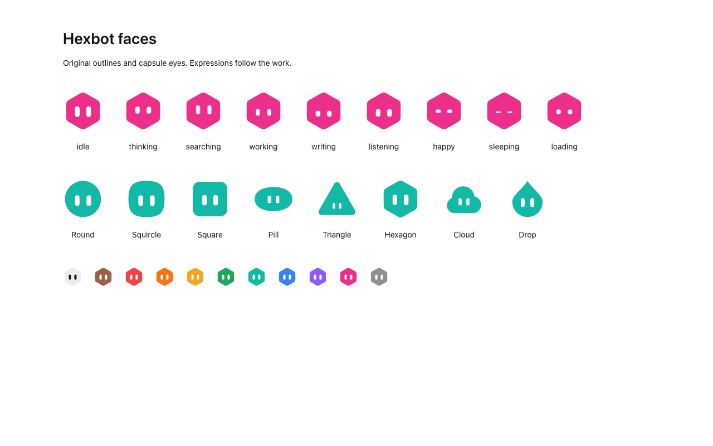
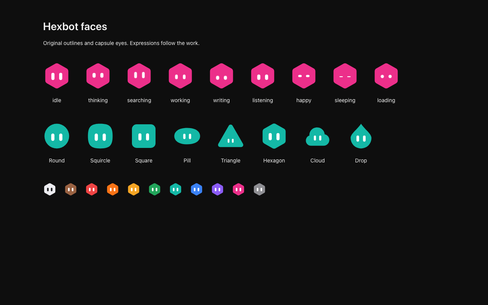

# Bot face provenance

The live faces use Hexbot's own eight 100-unit outlines, palette, ball
placement, and capsule eyes from `apps/web/src/lib/avatar-builder.ts` on
`main` at `e44f26c8`. They are now in `lib/face-geometry.ts`, under the
repository's existing AGPL-3.0 license, as recorded in `LICENSE` and
`NOTICE`. New activity expressions change capsule sizes and positions. CSS moves the eyes slightly while a bot thinks,
searches, writes, or works. No external face engine, geometry, behaviour
dataset, voices, or particle assets are included.

PR #123 proposes a different face, adapted from Morph Bot in
iduu/grokbot-animation. That repository declares no license for its face
engine. Its README says the geometry and behaviour data derive from a
publicly delivered x.ai frontend snapshot and that it grants no open-source
license for those reference assets. No grant covering that engine or data
has been identified. Permission from whoever holds the rights to that
material, or original replacements for it, could change that; this document
makes no claim about who holds those rights. None of that material is used
here: this change starts from `main`, so the vendor tree, its
reference-derived data, and its generated rest poses are in neither its
history nor the shipped bundle.

`node apps/web/scripts/face-rest.mjs` copies the original geometry module to
mobile, which draws settled poses without animation. Pass `--check` to
verify that copy. PNGs use the original idle pose and format. The web app
still reads both the current capsule-eye PNGs and older flat-eye PNGs back
into a live face. Photos remain pictures.

Idle, listening, happy, sleeping, held, offscreen, and reduced-motion faces
have no continuous face animation. React owns every SVG node, including the
existing click acts. Visibility observers and act timers disconnect on
unmount. There are no face animation frame callbacks, springs, custom
elements, or detached particle layers.

The site logo, favicon, and desktop package icons intentionally keep the
original static Hexbot mark. The in-app mark keeps the same outline and
colours and changes its eyes with activity. Saved avatar pictures are also
intentionally static.

The browser verification captures the rendered components in both themes:

