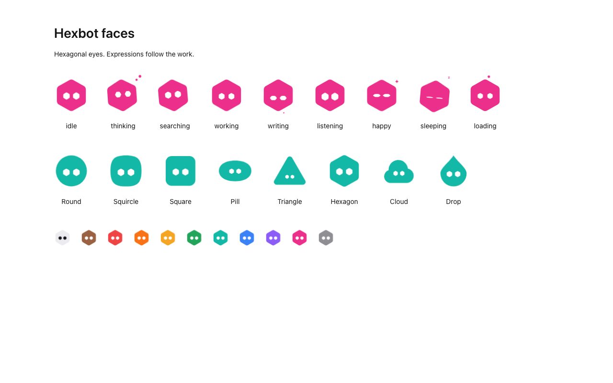
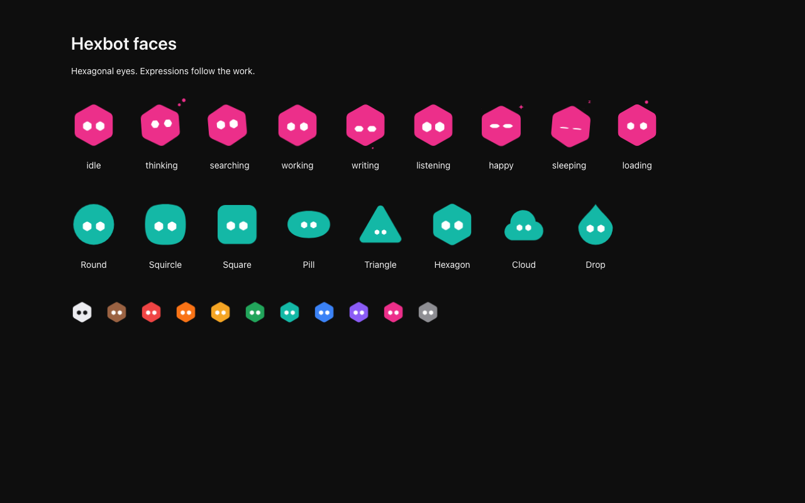

# Bot face provenance

Hexbot's faces are its own artwork under the repository's license
(Apache-2.0, see `LICENSE` and `NOTICE`). The eight 100-unit outlines,
palette, and ball placement come from `apps/web/src/lib/avatar-builder.ts`
and now live in `lib/face-geometry.ts`. The eyes are hexagons with softened
corners (`HEX_EYE`), drawn for Hexbot to echo its name and mark. Every
expression is one pose of that hexagon: where it sits, how large it is, how
flat, and whether it stands on a point or lies flat. Each mood also moves
the whole face (a breath, nod, tilt, sway, bob, hop, or droop), blinks and
glances the eyes, and may draw marks around the face: hexagonal thought
dots, a written line, four-point sparks, Zs, a circling dot. While a bot
works, each eye turns a sixth of a turn and rests, the two in opposite
directions like meshed gears. Every motion is a CSS keyframe in
`styles/tokens.css`, designed for Hexbot; none of the timings, shapes, or
behaviours are taken from another face.

No external face engine, geometry, behaviour dataset, voices, sound samples,
or particle assets are included. Nothing here is taken from xAI's bot, its
Grok products, the Morph Bot reconstruction in iduu/grokbot-animation
(proposed in #123, closed), or Cursor. The earlier faces used upright white
capsule eyes; those were replaced because they resembled xAI's bot.

Sound cues (`lib/sounds.ts`) are synthesised at run time from sine notes,
with no recorded audio. They are off until the user turns on Sounds in
Settings, Appearance.

`node apps/web/scripts/face-rest.mjs` copies the geometry module to mobile,
which draws settled poses without animation. Pass `--check` to verify that
copy. PNGs use the idle pose. The web app still reads hexagon-eye, older
capsule-eye, and older flat-eye PNGs back into a live face: hexagon and
capsule eyes share their centres. Photos remain pictures.

Held, offscreen, hidden-page, and reduced-motion faces have no running face
animation; reduced motion keeps each pose and its marks. React owns every
SVG node, including the marks and the existing click acts. There are no
face animation frame callbacks, springs, custom elements, or detached
particle layers.

The site logo, favicon, and desktop and mobile package icons still show the
static mark with capsule eyes. They are raster or Icon Composer artwork,
outside this change; redrawing them with hexagon eyes is a separate step.

The browser verification captures the rendered components in both themes:

