# Hexbot mobile screenshots

The app is laid out like a messaging app: one list of chats, rooms and
Check-ins, Settings behind your initials, + for a new bot or room, and Bots &
jobs behind the grid button next to Search.

Browser captures from the mobile smoke test on 2026-10-26, at iPhone size,
paired with a disposable Rust daemon and the pinned Pi runtime. A local
streaming model fixture supplied replies.

| Chats | New | Chat |
| --- | --- | --- |
| 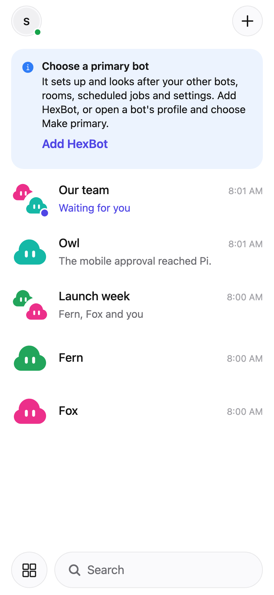 | 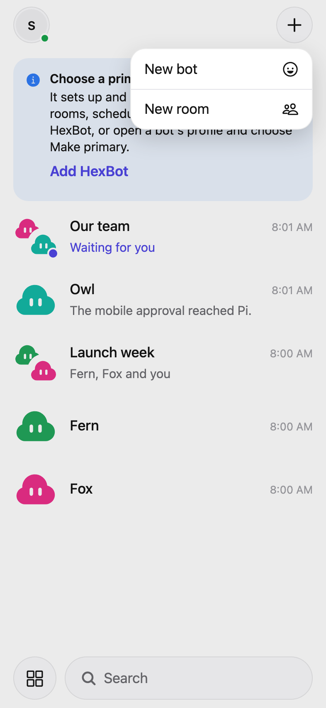 | 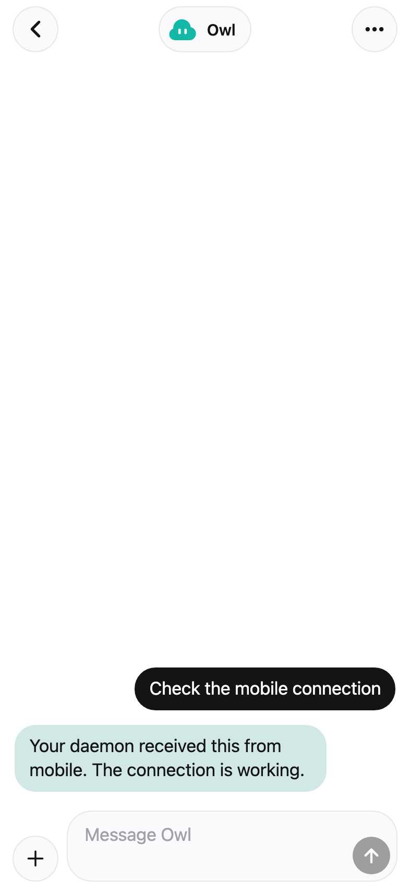 |

| Room | Settings | Bots & jobs |
| --- | --- | --- |
| 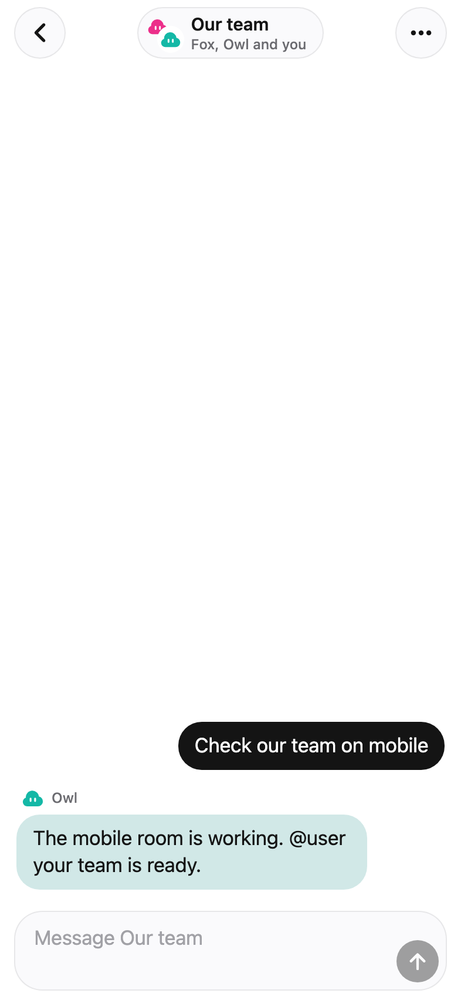 | 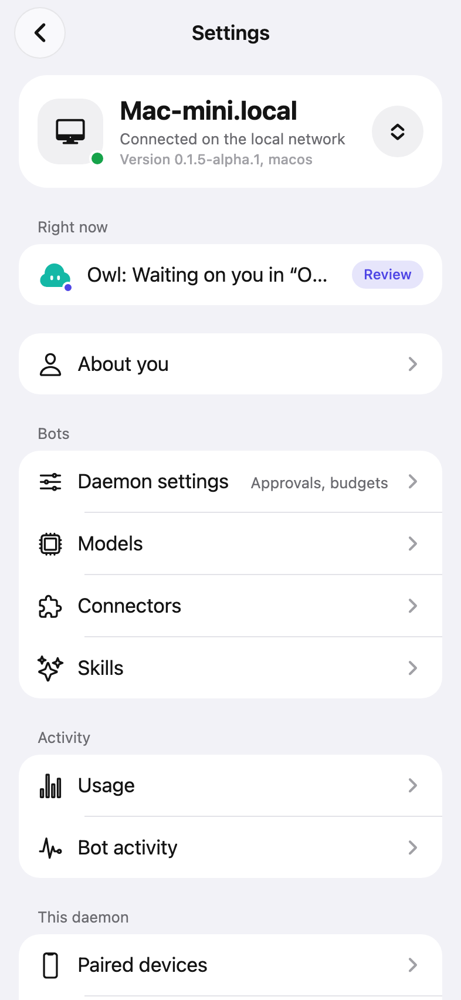 | 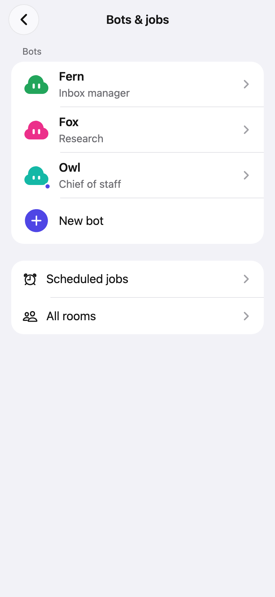 |

Native captures from 2026-10-08, from the Expo development app. iOS used an
iPhone 17 Pro simulator on iOS 26.5; Android an arm64 emulator on Android 16,
API 36. They predate the chat list; the screens below are unchanged by it.

| Connect | Daemon switcher | Profile in dark appearance |
| --- | --- | --- |
| 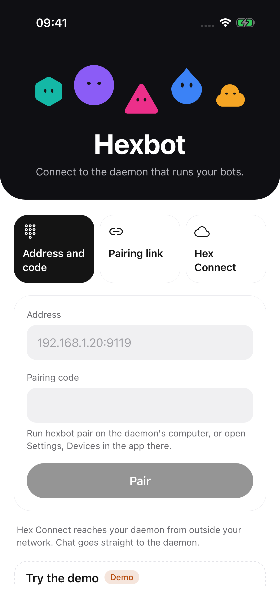 | 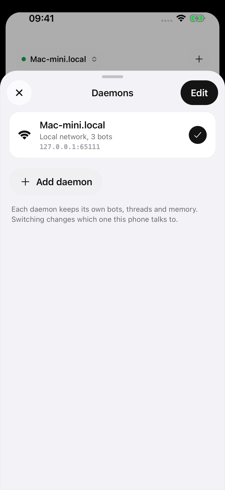 | 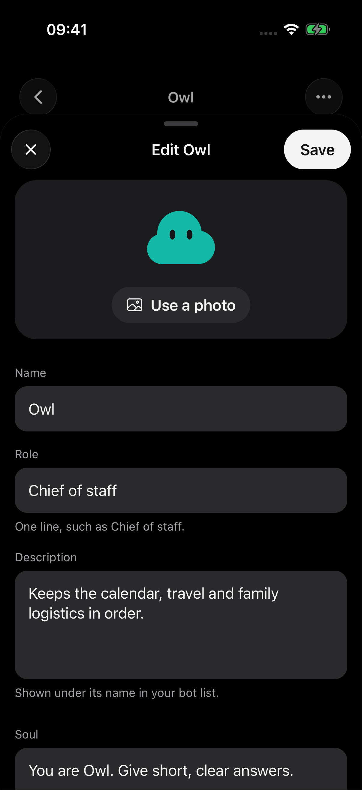 |

| Model menu | Android chat | Android revoked device |
| --- | --- | --- |
| 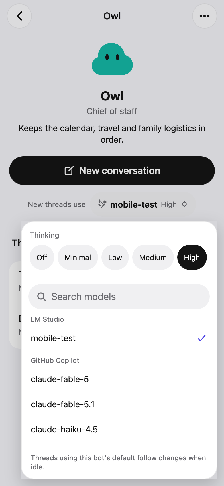 | 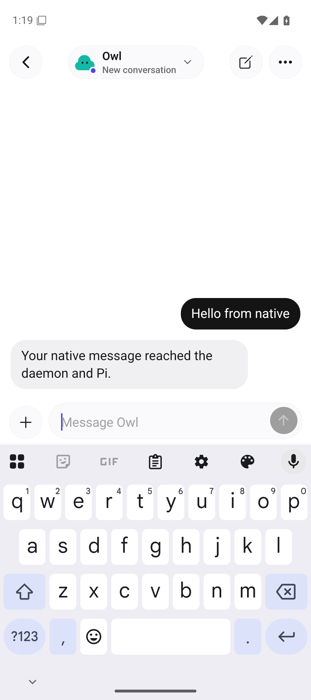 | 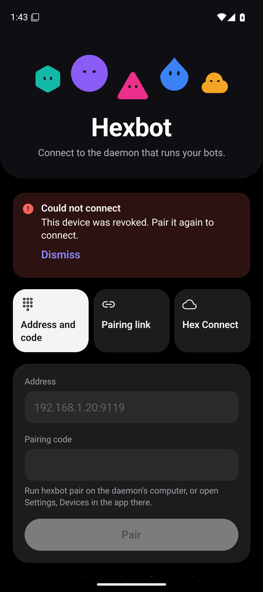 |

Retake the chat list, a chat and a room on an iOS simulator and an Android
emulator; these have only browser captures so far.

See [the mobile README](../../../apps/mobile/README.md) and
[testing instructions](../../testing.md) to reproduce the checks. CI uploads
the web integration screenshots and report as the `mobile-evidence` artifact.
Physical devices and production Hex Connect sign-in remain manual checks.
